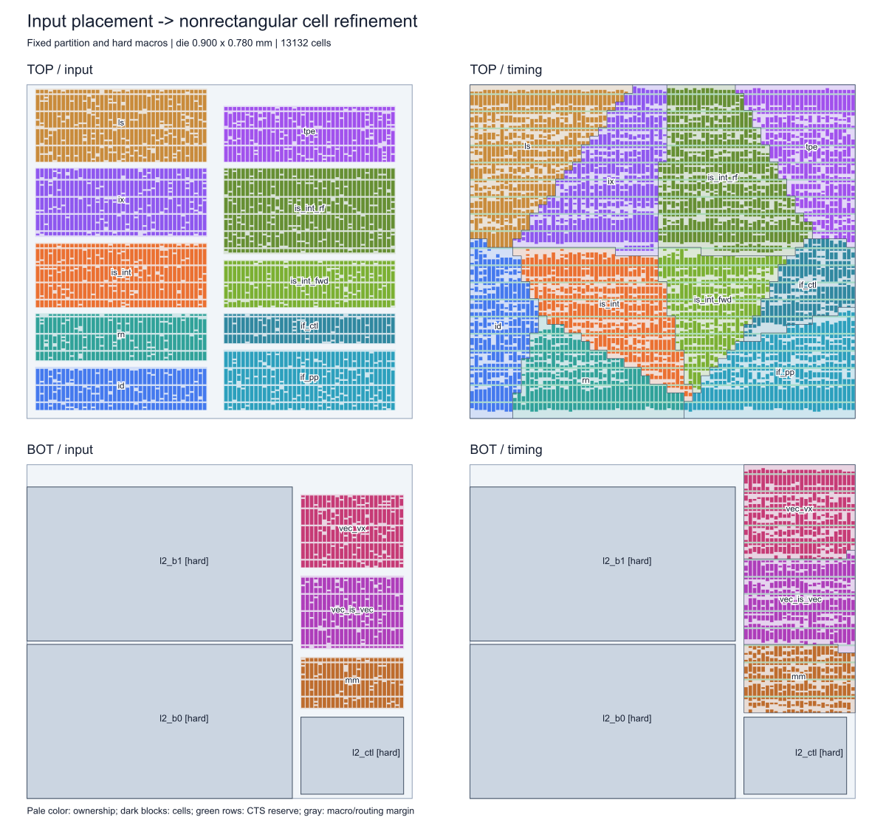
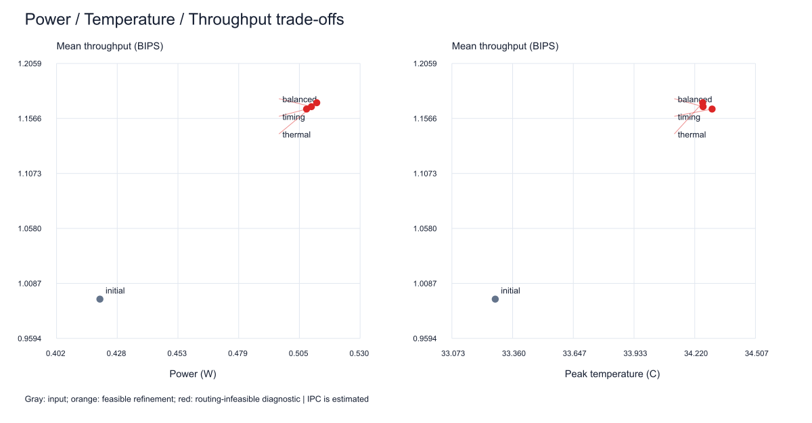

# cell-3D：从模块级最优解继续细粒度布局优化

保留已有 BOT/TOP 分层和硬模块位置，将软模块矩形拓展为形状受约束的非矩形区域，再优化 cell 坐标和路由候选。算法以解析梯度和 Adam 为主。

## 输入关系

- [`config.yaml.json`](config.yaml.json)：模块级布局最优解，决定最终分层、die、坐标、硬模块和显式限制。实际内容是原布局摘要文本，保留其格式；同格式 `config.yaml` 也可读取。
- [`folding_dse_annealing_cfg.yaml`](folding_dse_annealing_cfg.yaml)：提供缺少的模块功耗、模块对连接数量、时钟周期、热堆栈和其他物理参数。完整仓库默认读取上一级 `folding_dse/` 中的配置，独立便携包默认读取包内配置；CLI 可以显式指定。
- 输入温度只作参考，不反推功耗；模块名称别名自动规范。布局和辅助配置冲突会报告，布局显式值优先。

当前模块动态功耗合计 0.845 W，18 对模块连接。所给互连是模块对的信号数量，并不是完整门级网表，按最终分层计算跨层信号为 1360；程序保留原数量并提示其与布局摘要 8582 的差异。

## 运行

源码需要 Python ≥3.9、NumPy ≥1.24；无需 GPU。

```sh
python -m pip install -r cell-3D/requirements_portable.txt
python cell-3D/run_layout.py --check
python cell-3D/run_layout.py --config cell-3D/config.yaml.json --annealing-config cell-3D/folding_dse_annealing_cfg.yaml
python cell-3D/test_layout.py
```

Windows 可以在该目录运行 `run_layout.cmd`；Linux 可以 `sh cell-3D/run_layout.sh`。`--quick` 用于环境检查，正式默认迭代为区域 360 步、cell 180 步、路由选择 160 步。每次输出保存在独立的 `runs/日期/时间_layout/`，不覆盖旧结果。

Windows 10/11 x64 云桌面可下载 [离线包](releases/cell3d_windows_x64_offline.zip)（约 28 MB），解压后修改配置并双击 `run_layout.cmd`，无需联网安装 Python/NumPy。另有 [源码包](releases/cell3d_source.zip) 和 [SHA256](releases/SHA256.json)。

默认温度后端是热阻代理模型。需真实 HotSpot 最终温度时，先编译仓库中的 `third_party/HotSpot`，再传入 `--hotspot-exe`，或在 Windows 使用已有 WSL 发行版并传入 `--hotspot-wsl`。编译/运行命令及换环境说明见 [PORTABLE_RUN.md](PORTABLE_RUN.md)。

## 留白与结果

模块所属区域可以接壤，实体 cell 保留留白：当前每 10 行预留一行、cell 左右各 1 μm padding、硬宏周围至少 4 μm keepout。所有 cell 检查行/site 对齐、不重叠及区域包含 padding；区域检查连通、无孔、包围盒比例和紧凑度。

[2026-10-13 完整运行](runs/20261013_release/index.html) 保存四组方案、逐 cell 坐标、指标表、形状检查和 HotSpot 输入输出。下载仓库后在浏览器中打开 `index.html`；GitHub 可直接查看下方图片和 [指标 CSV](runs/20261013_release/metrics.csv)。





在相同名义 3.003 GHz 下，HotSpot 估算峰温从 44.40°C 降至最低 43.46°C。**当前所有候选仍存在估算布线溢出，没有可行最优解**；`winner=null`，图中红点是不可行诊断方案，不能据此宣称后端可签核。图中的运行温度和功耗是在估算延时限制下调整频率后的数值，不能和相同名义频率的指标混淆。

cell 尺寸、模块内部网络、RC 和路径延时仍为估算；IPC 来自随包 gem5 基线的解析外推，没有重新运行 gem5、STA、CTS 或详细布线。该算法借鉴可微优化思路，并非 NVIDIA tier assignment 论文完整复现。

- [本次结果、基本算法和数学原理](LAYOUT_RUN_RESULT.md)
- [配置优先级、参数与移植说明](PORTABLE_RUN.md)
- [环境移植验证记录](PORTABILITY_VALIDATION.json)
- [本次运行的有效输入](runs/20261013_release/effective_input.json)
- [完整估算参数](runs/20261013_release/assumptions.json)
