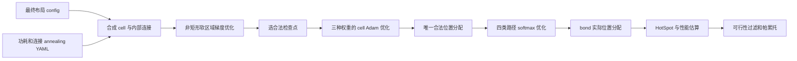

# 2026-10-13 细粒度优化：改了什么、数学原理、怎样运行

本次是以已定的模块级最终布局为基础，固定 die、BOT/TOP 和硬宏，优化软模块的非矩形区域及合成标准单元坐标，再优化外部连接路径。使用解析梯度和 Adam。当前结果几何合法，但所有方案仍有布线溢出，因此没有可用于后端的“最优解”。

本文对应 [当前代码](../src/run_layout.py)、[原发布结果](../results/2026-10-13/20261013_release/README.md) 与 [整理后正式复跑](../results/LATEST.md)。原发布源码逐字节存于 archive/source_snapshots/2026-10-13/published_flat；复跑坐标、区域、连接、路径选择和指标的比较证据存于 docs/REORGANIZATION_VALIDATION.json。

## 1. 两类修改要分清

今晚之前的早期代码使用估算矩形场景/合成参数。今晚发布实现了：读取用户最终摘要作为布局权威；从 annealing YAML 取真实模块功耗和连接数量；统一别名；保持硬宏/分层；软模块区域越过旧矩形形成拼图；梯度放置后合法化；保留后端行/单元/宏/bond margin；可选真实 HotSpot；显式记录所有假设和不可行结果。

早期完整运行曾因 if_ctl 区域紧凑度约 3.68 超过 2.5 而失败（20261013_full）。后来改为在相同最终温度参数下评估多个区域检查点，选目标最小且满足形状检查的点，**没有放宽形状限制**。正式版本选中区域 step=120，拒绝 6 个非法检查点。

这轮整理仅修改路径、启动器、归档/索引与便携打包，并补齐说明；没有改变 Regions/Cells/Routing/evaluate 的数学计算。整理后通过完整复跑确认与原发布结果一致。不要把这轮目录修改误认为新一代优化算法。



## 2. 输入、量纲和假设

所有布局坐标在内核中使用 mm，延时 ns，频率 GHz，功耗 W，温度 °C。完整实际参数见每次 assumptions.json，解析输入见 effective_input.json，原件保存在 input_* 文件。

|参数|实际值/处理|来源|
|---|---|---|
|die / 分层|0.900×0.780mm；BOT 6、TOP 10 模块|最终 config，固定|
|模块坐标、硬宏|x/y/w/h 来自最终解；l2_b0、l2_b1、l2_ctl 固定|最终 config|
|模块温度|约 43°C 的输入参考；不反推功耗|最终 config|
|HBT pitch、高度、密度|5µm、6µm、40000/mm²|最终 config；辅助 20000 冲突提示但不覆盖|
|模块动态功耗|合计 0.845W，各模块原值|annealing power_w；不额外添加未知 leakage|
|外部连接|18 对，10920 根；最终分层跨层 1360 根|annealing interconnect；保留数量、不缩放到摘要 8582|
|时钟、bond 延时|333ps→3.003003GHz；100ps|annealing timing|
|线 RC 温度系数/参考|0.0039/°C、27°C|annealing|
|环境温度、热堆栈、封装|26.85°C；下面表格|annealing|
|关键模块/连线权重、距离软约束|原值，经别名统一|annealing；不改最终分层|
|bond 窗口/预留|0.10mm 固定窗口、20% 预留|annealing；信号上限 32000/mm²|
|cell 尺寸/初始利用率|8×4µm、原软矩形面积的 65%|估算；不是工艺库单元|
|cell padding / CTS 行|左右各 1µm；每十行预留一行|估算；当前槽宽 10µm|
|宏 keepout|4µm|源 module_gap=8µm 的一半；区域网格会量化|
|形状网格/形状限制|20µm；长宽比≤3、紧凑度≤2.5、面积误差≤25%|估算；硬验证|
|形态预处理|3 tiles 尺度的 opening|估算；不是所有局部颈宽的精确 DRC|
|cell 密度目标上限|70%|估算；软罚项，不是最终密度签核|
|电压/活动率|0.8V、0.12|估算|
|线/键合电容|0.20pF/mm、0.004pF/bond|估算|
|线延时系数|0.11ns/mm、0.04ns/mm²|估算|
|逻辑温度系数|0.0012/°C|估算|
|布线容量|12000 tracks/mm，宏内容量×0.45|估算，不是真实 routing layer stack|
|温度上限|95°C|估算|
|IPC 基线|2GHz 的 stream/matmul gem5 统计|data/layout_baseline.json；不是本轮 gem5 仿真|

辅助配置旧坐标/旧 die/旧 tier 不重新导入。vec_vx/vec_is_vec 的 TOP 偏好与最终 BOT 冲突，因此保留 BOT 并在 selected_soft_constraints.csv 报告未满足。12 个距离限制是软目标，多数仍未达到。输入并不是真实 gate-level netlist：interconnect 只有模块对和数量，内部连线和端点都由固定 seed 合成。

热堆栈：

|层|厚度 µm|导热率 W/(m·K)|体积热容 J/(m³·K)|
|---|---:|---:|---:|
|bottom Si|50|130|1630300|
|HB interface|2|1.4|2200000|
|top Si|50|130|1630300|
|TIM|20|4|4000000|

HotSpot 封装 r_convec=1.042K/W。体积热容写入真实热工具的材料输入，本次只评估稳态。当前 hbt_vert=6µm 被读取和留档，但没有直接转换成 RC 线长或 bond 延时，bond 延时使用源 100ps；不能声称高度已完整进入电气模型。

## 3. 合成 cell 和网

软模块 i 的单元数量为：

$$N_i=\operatorname{round}\left(0.65\frac{w_i h_i}{A_{cell}}\right),\quad A_{cell}=8\times4\ \mu m^2.$$

初始 cell 从原矩形内的唯一合法槽位抽样；有 padding 和预留行。硬宏不拆为可移动单元，每个宏使用 8×8 固定采样点表示端口和功耗分布。合计 13132 个可移动 cell +192 个固定点=13324 个点。

每个软模块生成两组“每个 cell 连到随机排列的 cell”内部连接，共 26264 条；外部按照 18 对的原数量随机选端点，共 10920 条。合计 37184 条两端连接。这是随机代理结构，不是网表提取。每模块功耗均分到所属点，模块总功耗保持不变。

## 4. 拼图区域：可微归属概率

固定硬宏及 keepout，从剩余平面移除形态处理后的薄 margin，再把可分配网格位置 r 分给同层软模块。每层模块目标比例按该层原始软模块矩形面积归一化，**不是照原矩形边界固定区域**。

模块中心为 c_m，面积调节变量 w_m，以加权距离生成软归属：

$$q_{rm}=\frac{\exp((w_m-\|r-c_m\|^2)/\tau)}{\sum_j\exp((w_j-\|r-c_j\|^2)/\tau)}.$$

每个位置所有 q 的和为 1，连续期间允许混合归属。w 越大，该模块更容易获得面积；c 改变区域位置。τ 从大到小使归属逐渐变硬。这里的降温是连续 softmax 松弛过程，不是模块级模拟退火的随机接受规则。

令 a_m=mean_r(q_rm)，t_m 为目标比例，p_m 为软区域质心，A 为面积罚项，S 为相邻平滑罚项。每层目标含：

$$J_{region}=\sum_z\left[35\sum_m\left(\frac{a_m-t_m}{t_m}\right)^2+\frac1{|R_z|}\sum_{r,m}q_{rm}\|r-c_m\|^2+0.35\operatorname{mean}_{(r,s)}\sum_m(q_{rm}-q_{sm})^2+0.025\operatorname{mean}_m\|c_m-c_m^0\|^2\right]+J_{links}+J_{constraints}+J_T.$$

链接项：`0.08 × 按原连接数量加权的平滑 Manhattan 质心距离`，平滑 ε=0.002mm。距离约束项：`(源 constraints 权重/约束条数) × Σ max(distance/limit−1,0)²`，ε=0.0004mm。热项：`0.3 × (LSE₂(T)−T_ambient)/40`。

梯度利用 softmax 雅可比：

$$\frac{\partial q_m}{\partial s_j}=q_m(\delta_{mj}-q_j),\quad s_m=\frac{w_m-\|r-c_m\|^2}{\tau}.$$

因此目标对所有 q 的导数可以传回 w 和 c；热和连接项通过软质心/归属传播。无需逐变量有限差分来优化；有限差分只用于验证解析梯度。

先进行 60 次面积/质心 warmup，每次每层 35 次面积调节。随后 Adam 360 次，τ 从 `0.055·max(die)²` 降到 `0.004·max(die)²`。中心学习率从 `0.005·max(die)` 线性下降到其 30%，w 学习率再乘 0.2。

每 40 次保留检查点，加入 warmup 和末点。对每个点以**同一个** `τ=0.001·max(die)²` 再做 400 次面积调节，然后 argmax 离散化并修复孤岛。最终硬检查：

* 无缺口/重叠，归属覆盖恰好等于 eligible plane；每模块单个连通分量、无孔洞。
* 包围盒长宽比≤3；紧凑度 `P²/(16A)≤2.5`；相对目标面积误差≤25%。P 是网格边界真实周长，A 是区域面积。
* 从合法点中选同一最终 τ 下目标最低者；无合法点直接失败。

13 个软区域通过检查。区域“铺满”的分母已经排除了硬宏、keepout 和薄路由 margin。实际 cell 仍留空隙，不能把区域覆盖率 100% 解释成无后端空间。

## 5. cell 位置：解析梯度与 Adam

三个权重方案共享同一个区域划分。每个方案先把 cell 重分配到新区域位置，再优化连续坐标。因此前后变化同时包含区域扩张、重新初始化和梯度移动，不是单纯 180 次坐标下降的效果。

网 e 两端差为 Δ，平滑 Manhattan 长度：

$$L_e=\sqrt{\Delta x_e^2+\epsilon^2}+\sqrt{\Delta y_e^2+\epsilon^2},\quad\epsilon=0.0004\ mm.$$

导数 `∂L/∂x=Δx/√(Δx²+ε²)`，两端反号。连续放置阶段路径延时：

$$d_e=d_e^{logic}+0.11L_e+0.04L_e^2+0.1I_e^{cross}\quad(ns).$$

逻辑代理为 Uniform(0.24,0.35)ns，外部连接再加 0.035ns。这不是 Liberty 延时/完整逻辑路径。用平滑最大值突出较慢连接：

$$\operatorname{LSE}_\eta(d)=\eta\log\sum_e\exp(d_e/\eta),\qquad\frac{\partial\operatorname{LSE}}{\partial d_e}=\operatorname{softmax}(d/\eta)_e.$$

关键连接长度加权使用源 net_weights。双线性 splat 把 cell 面积/功耗分配到两层 16×16 网格；密度为 ρ，目标为 ρ_target。实际目标：

$$J_{cell}=w_w\left[0.45\lambda_{WL}\frac{\operatorname{mean}(critical_e L_e)}{0.25}+1.5\lambda_{timing}\frac{\operatorname{LSE}_{0.012}(d)}{0.5}\right]+35\,spill\_coef\operatorname{mean}(\rho-\rho_{target})^2+0.03\,viol\_penalty\_coef\operatorname{mean}(\max(\rho-0.70,0)^2)+w_T\frac{\operatorname{LSE}_2(T)-T_{ambient}}{40}.$$

λ_WL/λ_timing 取辅助配置；spill_coef/viol_penalty_coef 取最终配置。其他辅助优化权重并非全部直接套入此公式，区域/路由使用上述固定系数，不能声称完整复用了退火算法的 objective weights。

|方案|w_w|w_T|含义|
|---|---:|---:|---|
|balanced|1.0|0.45|当前默认折中|
|timing|1.8|0.12|同时强化线长与延时项|
|thermal|0.45|1.2|增强热项，同时降低线长/延时项|

热阻模型为线性稳态 `K(T−T_ambient)=p`，K 包含横向、层间、散热导纳，材料从热堆栈派生。当前代理导纳为 lateral=0.0065、vertical_at_16≈0.005515、sink_at_16≈0.001926，并使用封装公共热阻 1.042K/W。

对热目标 J_T，其伴随导数是：

$$u=K^{-T}\frac{\partial J_T}{\partial T},\quad\frac{\partial J_T}{\partial x_i}=u^T\frac{\partial p}{\partial x_i}.$$

K 对称，因此代码用相同 Heat.apply 求伴随场，再对双线性沉积权重求导。放置热梯度仅包含模块功耗沉积，不包含估算 wire power 的梯度；终态评价才加入 wire power。

Adam 操作：

$$m_t=0.9m_{t-1}+0.1g_t,\ v_t=0.999v_{t-1}+0.001g_t^2,$$
$$x_{t+1}=\Pi_{region}\left(x_t-\alpha_t\frac{m_t/(1-0.9^t)}{\sqrt{v_t/(1-0.999^t)}+10^{-9}}\right).$$

180 次 cell 更新，学习率 `0.004·max(die)` 下降到其 20%。硬宏梯度清零；每步投影回所属区域。保留连续目标最低的位置，最后贪心分配到各模块的唯一空槽位：位置在合法行、满足区域/padding/宏禁区、无重叠；合法化是离散步骤，可能增加连续目标，代码没有宣称合法化后仍单调下降。

## 6. 路由：四种路径概率及真实 bond 分配

cell 和区域固定后，外部每条两端网选择四种候选：XY/YX × BOT/TOP 主干层。同层连接借另一层时需要 2 个 bond，跨层连接需要 1 个；内部合成网作为固定 XY 背景需求。

令 `p_ek=softmax(logits_e)_k`，候选对路径边需求 a_ekl、对 bond 网格需求 v_ekb。期望需求：

$$D_l=D_l^{internal}+\sum_{e,k}p_{ek}a_{ekl},\quad H_b=\sum_{e,k}p_{ek}v_{ekb}.$$

优化目标：

$$J_{route}=12\operatorname{mean}_l\max(D_l/C_l-1,0)^2+5\operatorname{mean}_b\max(H_b/H_b^{cap}-1,0)^2+\frac1{N}\sum_{e,k}p_{ek}via_{ek}(0.08+0.04critical_e).$$

通过 softmax 雅可比反传 logits，Adam 学习率 0.15，160 次。金属容量采用 12000 tracks/mm 的代理，宏内部×0.45；不是工艺真实布线资源。softmax 得到连续期望可微需求，结束后 argmax 选择离散路径，因此离散化后需求可能更差。

随后在真实 5µm 唯一 pitch sites 上给 bond 分配位置，固定 0.10mm 窗口内限制≤32000/mm²，边缘部分窗口按实际面积计算。若找不到合法位点就失败。bond 偏离理想位置带来的 `2×Manhattan(endpoint,bond)` 绕路加入线长，并在两层消耗 tracks；它进入终态电气评价。

这不是连续 tier assignment：模块层固定，优化的是主干金属路径层；没有可移动 z/tier 变量。路径优化与 cell 放置是串行，终态绕线/bond 离散变化没有回馈 cell 梯度重优化，也没有 sliding-window DRC 或详细布线器。

## 7. 功耗、温度、时序、IPC 如何得到

外部线功耗估计：

$$P_{wire,e}=\alpha V^2 f_{nom}\left(C_{wire}L_e+C_{bond}via_e\right),\quad P_{nom}=0.845W+\sum_{e\in external}P_{wire,e}.$$

内部线没有另加该项，以免在已供应模块动态功耗之外重复粗估。代码 pF/GHz 换算系数为 0.001。工作频率 f 的所有动态功耗按 f/f_nom 线性缩放，电压固定，不模拟 DVFS 电压和 leakage。

真实 HotSpot 每个候选在标称功耗下运行一次（共 4 次），64×64 原生网格峰值被保留。降频温度采用 `T(f)=T_ambient+(T_nom−T_ambient)f/f_nom`。本次稳态线性模型支持这种缩放；不代表含非线性温度泄漏的真实芯片。

终态延时加入温度系数：

$$d_e(f)=d_e^{logic}[1+\alpha_{logic}(T_e(f)-27)]+[0.11L_e+0.04L_e^2+0.1via_e][1+0.0039(T_e(f)-27)].$$

T_e 取两端采样温度较高者。用 28 次二分搜索，找满足 `max(d_e(f))·f≤1` 且峰温≤95°C 的最高 f（不超过标称）。标称 WNS 为 min_e(333ps−1000d_e)，TNS 为负 slack 求和；这些是合成两端连接代理时序，不是真正 STA 的路径 slack。降频成功不意味着 333ps 时序通过。

IPC 来自封装 gem5 基线的 CPI 外推。stream/matmul 的估算内存时间比例分别 0.35/0.12。L2 相关连接附加延时取 P95，转成 `cycles=max(1,ceil(link_ns·f))`：

$$CPI(f)=CPI_0[(1-m)+m f/2GHz]+access_{L2/instr}\times0.25\times(cycles-1),$$
$$IPC=1/CPI,\quad BIPS=f_{GHz}/CPI,\quad E_{instr}=P/\operatorname{mean}(BIPS)\quad(nJ/instr).$$

IPC 可能降而 BIPS 升，因为工作频率提高；应一起看。没有重新跑 gem5，也没有模拟 cache coherence/详细乱序核心的布局延时反馈。

## 8. 标称与工作点结果、Pareto

比较热优化首先应在相同 3.003003GHz 下看：

|方案|标称功耗 W|标称峰温 °C|标称 WNS ps|布线溢出 tracks|
|---|---:|---:|---:|---:|
|initial|1.147796|44.3954|−598.592|7255.00|
|balanced|1.147028|43.5252|−430.106|7694.00|
|timing|1.144984|43.6585|−432.300|7533.75|
|thermal|1.147816|43.4593|−428.292|7570.75|

热方案降低约 0.936°C，但布线仍失败，且比 initial 更拥塞。通过代理延时二分降频后的工作点：

|方案|频率 GHz|功耗 W|工作峰温 °C|平均 BIPS|
|---|---:|---:|---:|---:|
|initial|1.100127|0.420486|33.2776|0.994650|
|balanced|1.334415|0.509693|34.2598|1.167123|
|timing|1.331437|0.507650|34.3024|1.164998|
|thermal|1.339368|0.511937|34.2579|1.170655|

区域和单元几何都合法；当前脚本实际 feasible 过滤主要为“路由溢出为零、工作峰温达标、工作频率>0.1GHz”，几何在前面单独硬验证。输入距离/tier 偏好、70% 密度、标称 333ps 通过均不是这个 feasible 的组成条件。bond pitch/固定窗口由分配器检查；不是完整后端 DRC。

Pareto 在功耗/温度越低、BIPS 越高的三目标上定义：若另一候选三个都不差且至少一个严格更好，则该候选被支配。先过滤 feasible，再求非支配集合。本次 `winner=null`、`pareto=[]`。另存包含不可行候选的 diagnostic_pareto，以便观察折中，图上不能当作正式可行前沿。selected=timing 是优化候选中布线溢出最少者，不是全体（含 initial）溢出最少者。

仅扫描 balanced/timing/thermal 三组权重，不是充分的连续 Pareto 搜索，更不证明全局最优。

## 9. margin 是否保留

拼图填满的是“软模块所有权区域”，cell 并没有填到 100%。此组输入：

|层|eligible 软区域 mm²|实际 cell 面积 mm²|物理利用率|
|---|---:|---:|---:|
|BOT|0.1508|0.071776|47.60%|
|TOP|0.7020|0.348448|49.64%|

额外薄路由 margin 为 0.0256mm²，硬宏周边 keepout、每十行一行 CTS 预留、每 cell 左右 1µm padding、20% bond 资源预留。20µm 区域网格可能使宏实际预留大于 4µm。预留行/padding 与实际利用率有重叠，不能把百分比简单相加。

这些使后续插 buffer、CTS、拥塞处理具有空间余量，但没有运行真实 CTS/详细布线来证明余量够用。目前 overflow 更差正说明“形状拼满/面积低”不能替代布线可行性。die 仍是 0.9×0.78mm，没有缩小 die 面积；优化的是既定面积内的细粒度组织。

## 10. 如何复跑和审计

从 cell-3D 目录：

```powershell
python run.py --check --config configs/config.yaml.json --annealing-config configs/folding_dse_annealing_cfg.yaml
python -m unittest discover -s tests
python run.py --config configs/config.yaml.json --annealing-config configs/folding_dse_annealing_cfg.yaml --seed 20261012 --shape-steps 360 --cell-steps 180 --route-steps 160 --hotspot-wsl Codex-C910-gem5
```

正式复跑约 27 秒（本机 CPU 和 WSL），含 4 次 HotSpot；别的机器耗时不同。结果自动按日期归档，LATEST 指向新完成正式运行。无 HotSpot 参数时是代理温度，不能直接与上表真实 HotSpot 数字对比。

|核对目的|代码/数据入口|
|---|---|
|输入优先级、别名、冲突|layout_input.read_layout/read_auxiliary；effective_input.json|
|合成网、模块功耗|Model.__init__/wire_power；manifest.power_provenance|
|区域目标/检查点|Regions.objective/optimize/partition/validate；shape_trace.json/module_shapes.csv|
|坐标梯度/合法化|Cells.objective/optimize/legalize/validate；各方案_trace.json|
|热梯度|Heat.apply、splat/deposit/adjoint；tests 中有限差分验证|
|路由需求/离散化/bond|Routing.loss/optimize/assign；selected_route_guides/selected_bonds|
|温度真实后端|layout_hotspot.run_hotspot_grid；各方案_hotspot 原始文件|
|频率/功耗/IPC/WNS|evaluate；metrics.csv|
|Pareto 和诊断候选|pareto、main 最后候选选择；manifest.json|

还未实现 NVIDIA 论文的完整复现：没有真实网表与多引脚路由建模、可优化 tier/z、工业时序驱动权重闭环、工艺金属层资源、cell/route 联合迭代、真实 STA/CTS/详细布线、基准数据集及论文实验复现。当前只采用相近的可微松弛、梯度优化思想；不是该论文算法的等价实现。
